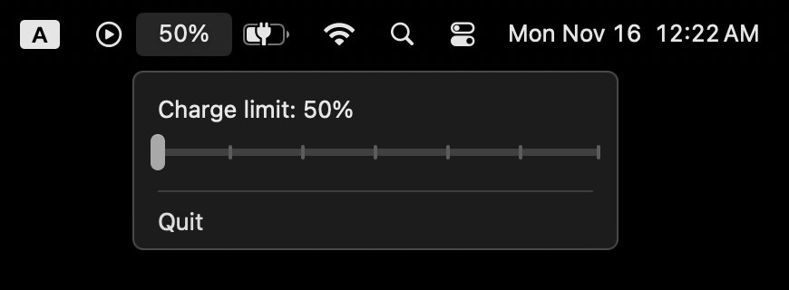

# Battery Charge Limit

A battery charge limiter for Apple Silicon Macs. Set a charging limit between 50% and 80% when your laptop is mostly plugged into wall power, to help extend your battery's lifespan.



## How It Works

When your battery reaches your chosen limit, charging automatically stops. The laptop then runs on wall power, and the battery neither charges nor discharges.

Charging resumes when the battery drops 3 percentage points below the limit. This avoids frequent small charging cycles.

## Features

- The menu bar item displays your current battery percentage next to the macOS battery icon.
- Clicking the percentage opens the menu.
- A slider sets your charge limit between 50% and 80%.
- **Quit** closes the app.
- When charging control is unavailable, the menu explains why and offers to install or reinstall the helper.

## Installation

1. Open the downloaded DMG file.
2. Drag **Battery Charge Limit.app** (battery icon) into your Applications folder. The DMG also contains **Uninstall Battery Charge Limit.app** (bin icon); leave that one inside the image.
3. Open the app from your Applications folder or Launchpad.

   If macOS blocks the app because it was downloaded from the internet, go to System Settings → Privacy & Security → **Open Anyway**, then open the app again.

4. When prompted, click **Install helper** and authorize with your password or Touch ID.
5. Add Battery Charge Limit to Login Items under System Settings → General → Login Items & Extensions.

The helper is a small background component that allows the app to control battery charging. Administrator authorization is required to install it.

Adding the app to Login Items allows it to restart automatically when you log in, so your charging limit is restored after a reboot.

**Important:** Close other battery charge management apps before installing to avoid conflicts.

## Uninstallation

1. Open the original DMG file.
2. Double-click **Uninstall Battery Charge Limit.app** — its icon is a bin.
3. If macOS blocks it, use **Open Anyway** under System Settings → Privacy & Security.
4. Confirm the removal and authorize with your password.

The uninstaller automatically:

- Stops the background helper.
- Restores normal macOS charging behavior.
- Removes the app and its background components.
- Clears the app's settings and login item.

If any cleanup requires manual action, the uninstaller tells you what to do.

## Privacy

Battery Charge Limit is designed to do its job without collecting your data.

- No analytics or usage tracking.
- No cloud connection or account required.
- No log files or statistics collection.
- No automatic updater.
- Saves nothing except your charging limit and your menu bar position.

Your settings stay on your Mac.

## Compatibility

Designed for Mac laptops with Apple Silicon.

**License:** MIT  
**Copyright:** © 2026 abneo.com

---

# Developer Documentation

The following sections are intended for developers and contributors.

## Architecture

The project consists of the following components:

| Component | Responsibility |
| --- | --- |
| `battery-charge-limit` | macOS menu bar application and settings |
| `bcl-helper` | Privileged background helper that controls charging |
| `bcl-uninstaller` | GUI uninstaller included in the DMG |
| `BCLCore` | Charging policy and battery status monitoring |
| `BCLSMC` | AppleSMC communication |
| `BCLShared` | Shared settings, capabilities, and XPC protocol |

### Charge Control

The helper controls charging through AppleSMC keys:

- `CH0B` and `CH0C`: Used to allow or inhibit charging.
- `CHTE`: Fallback control when the primary key pair is unavailable.

The helper releases charge control when the application disconnects or the helper exits, returning charging to the macOS default.

## Installation Details

The installer places the following files on the system:

- `/Applications/Battery Charge Limit.app`
- `/Library/PrivilegedHelperTools/com.abneo.batterycharge.limit.helper`
- `/Library/LaunchDaemons/com.abneo.batterycharge.limit.helper.plist`

The background service loads at boot and restarts if it exits unexpectedly. Charging control remains inactive until the application connects and provides a charge limit.

The application must also be added to Login Items so it can restore the charging limit after you log in.

### Command-Line Installation

```sh
sudo bash Scripts/install.sh "$PWD/dist/Battery Charge Limit.app"
```

This is the same script executed by the application's **Install helper** button.

Rebuilding the application changes its code signature hash (cdhash). Run the installer again after rebuilding to authorize the new version.

### Command-Line Uninstallation

```sh
sudo bash Scripts/uninstall.sh com.abneo.batterycharge.limit
```

## Helper Authentication

The project does not use `SMJobBless`, because it requires an Apple-anchored signing identity that is unavailable with ad-hoc signing.

Instead, `install.sh` reads the designated requirement of the installed application and passes it to the helper as a LaunchDaemon argument:

```text
cdhash H"…" and identifier "com.abneo.batterycharge.limit"
```

`ClientValidator` identifies the XPC client by process ID and validates it against this requirement.

A helper started without `--allow-requirement` rejects all clients.

Rebuilding the application changes its cdhash, so the installer must be run again before the new build can connect.

## Helper Diagnostics

The helper can also run directly from the command line:

```sh
.build/release/bcl-helper --probe
.build/release/bcl-helper --keys CH0B CH0C CHTE
.build/release/bcl-helper
```

- `--probe`: Checks available key groups, write permissions, and charging control state.
- `--keys`: Displays key types, sizes, attributes, and raw values.
- No arguments: Starts the XPC server. Without an authorized client requirement, it accepts no connections.

## Hardware Testing

Tested on:

- **Mac:** Mac14,15
- **macOS:** 15.6
- **SMC firmware:** 11881.140.96

Observed hardware configuration:

- `CH0B` and `CH0C` are present and used for charge control.
- `CHTE` is present but was not used in the tested configuration.
- No `BCLM` key was found.
- Ordinary-user processes cannot write to the charge-control keys, requiring the privileged helper.

### Charge Cycle Test

With the limit set to 50%:

1. Charging stopped when the battery reached 50%.
2. Disconnecting the charger allowed the control state to reset at 47%.
3. Reconnecting at 46% resumed charging.
4. Charging stopped again at 50%.

The `CH0B`/`CH0C` control path was verified end to end. The `CHTE` fallback has not yet been verified.

### macOS 27 Beta Compatibility

macOS 27 beta firmware versions 20457.0.125.0.2 and later add additional restrictions to the charge-control keys.

These keys require Apple's private `com.apple.private.iokit.soc-limit` entitlement. Administrator privileges alone are insufficient.

Compatibility with these firmware versions is therefore not currently supported.

## Menu Bar Positioning

The application positions its menu bar item immediately to the left of the macOS battery icon.

It reads the system's menu bar item positions and adjusts its own position when the target changes.

## Build and Test

Requirements:

- Xcode Command Line Tools
- Swift
- `rsvg-convert` (install with `brew install librsvg`)

Build and run tests:

```sh
swift build && swift test
```

Build the application and uninstaller:

```sh
bash Scripts/build.sh
```

Create the DMG:

```sh
bash Scripts/make-dmg.sh
```

The DMG is generated at:

```text
dist/Battery Charge Limit <version>.dmg
```

The build script creates both application bundles and signs them using ad-hoc signing by default.

Set `BCL_SIGN_IDENTITY` to override the signing identity.

### Code Signing and Gatekeeper

Builds use ad-hoc signing by default, so they do not have a Developer ID signature and cannot be notarized.

Locally built applications can be opened directly. Downloaded applications may require approval through:

System Settings → Privacy & Security → **Open Anyway**.

Alternatively, quarantine attributes can be removed manually:

```sh
xattr -dr com.apple.quarantine "/Applications/Battery Charge Limit.app"
xattr -dr com.apple.quarantine "/Volumes/Battery Charge Limit/Uninstall Battery Charge Limit.app"
```

## Continuous Integration

GitHub Actions (`.github/workflows/build.yml`) automatically:

- Runs the test suite.
- Builds both application bundles.
- Creates the DMG.
- Uploads the DMG as a build artifact.
- Attaches the DMG to GitHub releases when a `v*` tag is pushed.

## Disk Writes

The application only saves two types of preferences:

- Charging limit settings, when changed by the user.
- Menu bar position, when the menu bar is rearranged.

It does not create log files, caches, statistics databases, or update-related files.

---

MIT License. Copyright © 2026 abneo.com.
